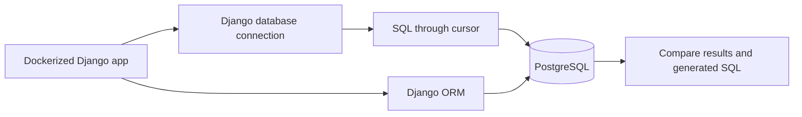

# DBAS 3200 — Workshop 04: Exploring SQL Through Python and Django

**Semester:** Fall 2026  
**Instructor:** Davis Boudreau  
**Workshop type:** Self-guided, hands-on SQL and Python exploration  
**Suggested weight:** 3% (confirm against course evaluation scheme)  
**Estimated time:** 4–6 hours, plus optional extensions  
**Prerequisite:** Completed Workshop 03 — Dockerized Django + PostgreSQL Application Development

## 1. Overview

### Purpose

In Workshop 03, you created a Django application (`myapp`) running in Docker with a PostgreSQL database. In this workshop, you will **reuse that same application and database** to explore common SQL operations and their equivalents in Python using Django's ORM.

You will perform operations two ways:

1. **SQL executed from Python** through Django's database connection and a cursor. This uses PostgreSQL's SQL syntax and Psycopg as the underlying driver.
2. **Django ORM** queries that express similar operations using Python objects and querysets.

**Why this matters:** A developer must understand what the database is doing, even when an ORM generates SQL automatically. The same understanding supports debugging, performance analysis, secure queries, and later application features.

### Learning objectives

By the end of this workshop, you will be able to:

- Confirm that the Django application is connected to PostgreSQL.
- Explain the roles of SQL, Psycopg, Django's database connection, and the Django ORM.
- Execute parameterized SQL queries from Python without embedding user input in SQL text.
- Use `SELECT`, `WHERE`, `ORDER BY`, `LIMIT`, `LIKE`/`ILIKE`, `COUNT`, `INSERT`, `UPDATE`, and `DELETE`.
- Compare each operation with its Django ORM equivalent.
- Explore grouping and aggregation, and inspect SQL generated by Django.
- Diagnose a query failure, verify results, and record evidence.

### Learning outcomes addressed

- **Outcome 1:** Implement a data access layer using Django ORM.
- **Outcome 2:** Create and manage a database connection.
- **Outcome 3:** Use a language-specific data access interface to retrieve and manipulate data.
- **Outcome 4:** Manipulate data within the application.

Use the approved course outline for authoritative outcome wording and numbering.

## 2. Learning journey

**Learn → Analyze → Predict → Try → Verify → Reflect**

For each activity: read the explanation, predict the result, run both SQL and ORM versions, compare results, and record findings in your Workshop Worksheet.



## 3. Prerequisite and readiness check

Open the **existing `myapp` directory** from Workshop 03 in your VS Code development environment (WSL Ubuntu on Windows). Do **not** create another Django project or PostgreSQL database.

```bash
docker compose up -d --build
docker compose ps
docker compose exec web python manage.py check
docker compose exec web python manage.py showmigrations
```

Visit <http://localhost:8000>. Confirm the Workshop 03 announcement appears.

Check that the model exists in `core/models.py`:

```python
from django.db import models

class Announcement(models.Model):
    title = models.CharField(max_length=120)
    message = models.TextField()
    created_at = models.DateTimeField(auto_now_add=True)

    def __str__(self):
        return self.title
```

If your Workshop 03 application uses a different model name, adapt the examples consistently rather than replacing your working model.

**Checkpoint 1 — Record:** container status, application URL, database engine, and one existing announcement.

## 4. Concepts and theory

| Concept | Meaning |
|---|---|
| SQL | Language for querying and modifying relational data |
| Psycopg | PostgreSQL adapter used by Django in this workshop |
| Cursor | Interface for executing SQL and reading result rows |
| Django database connection | Configured connection managed by Django; available as `django.db.connection` |
| ORM | Maps Django models and Python querysets to SQL operations |
| Parameterized query | Sends user-supplied values as parameters instead of concatenating them into SQL |
| Transaction | Unit of work that is committed or rolled back together |
| Migration | Versioned change to the database schema |

**Important:** Django's ORM and raw SQL access the **same database**. A raw SQL query does not create a separate database. For this workshop, Django manages the underlying connection; you do not need to manually open and close a separate Psycopg connection.

### SQL vs ORM at a glance

| Operation | PostgreSQL SQL | Django ORM |
|---|---|---|
| Select all | `SELECT * FROM core_announcement;` | `Announcement.objects.all()` |
| Select columns | `SELECT title FROM core_announcement;` | `.values("title")` |
| Filter | `WHERE title = %s` | `.filter(title=value)` |
| Sort | `ORDER BY created_at DESC` | `.order_by("-created_at")` |
| Limit | `LIMIT 5` | `[:5]` |
| Search | `ILIKE %s` | `.filter(title__icontains=term)` |
| Count | `COUNT(*)` | `.count()` |
| Insert | `INSERT INTO ...` | `.objects.create(...)` |
| Update | `UPDATE ... WHERE ...` | `.filter(...).update(...)` |
| Delete | `DELETE ... WHERE ...` | `.filter(...).delete()` |
| Group | `GROUP BY ...` | `.values(...).annotate(...)` |

## 5. Prepare repeatable test data

Open the Django shell inside the running web container:

```bash
docker compose exec web python manage.py shell
```

Paste this Python code:

```python
from core.models import Announcement

samples = [
    ("WS04: Docker basics", "Docker runs our development services."),
    ("WS04: SQL SELECT", "SELECT retrieves records."),
    ("WS04: SQL WHERE", "WHERE filters records."),
    ("WS04: Django ORM", "The ORM builds SQL from Python."),
    ("WS04: PostgreSQL", "PostgreSQL stores application data."),
]

# Safe to repeat: match on the unique workshop title and update the message.
for title, message in samples:
    Announcement.objects.update_or_create(
        title=title,
        defaults={"message": message},
    )

print("WS04 records:", Announcement.objects.filter(title__startswith="WS04:").count())
```

Expected WS04 record count: **5**. If you previously created other announcements in WS03, the total table count may be higher.

Keep the shell open for the activities below. If you exit, restart it and run:

```python
from core.models import Announcement
from django.db import connection
```

**Checkpoint 2 — Predict:** What should happen if you run the seed code twice? Verify that the number of `WS04:` records remains five.

## 6. Activity 1 — SELECT and retrieving rows

**What:** Read records from PostgreSQL.  
**Why:** Retrieving data is the foundation of data-driven applications.

### A. Execute SQL through Python

```python
from django.db import connection

with connection.cursor() as cursor:
    cursor.execute(
        "SELECT id, title, message FROM core_announcement "
        "WHERE title LIKE %s ORDER BY id;",
        ["WS04:%"],
    )
    rows = cursor.fetchall()

for row in rows:
    print(row)
```

### B. Execute the ORM equivalent

```python
rows = Announcement.objects.filter(
    title__startswith="WS04:"
).order_by("id").values_list("id", "title", "message")

for row in rows:
    print(row)
```

**Verify:** Both versions retrieve the same five workshop records in the same order.

**Worksheet:** Record the difference between `fetchall()` and a Django `QuerySet`.

## 7. Activity 2 — WHERE and parameterized queries

**What:** Retrieve records that match a value.  
**Why:** Applications filter records based on user selections and input.

```python
requested_title = "WS04: SQL WHERE"

with connection.cursor() as cursor:
    cursor.execute(
        "SELECT id, title FROM core_announcement WHERE title = %s;",
        [requested_title],
    )
    print("SQL:", cursor.fetchall())

print("ORM:", list(
    Announcement.objects.filter(title=requested_title).values_list("id", "title")
))
```

### Security test

Try a string that resembles a SQL injection attempt:

```python
requested_title = "WS04: SQL WHERE' OR '1'='1"

with connection.cursor() as cursor:
    cursor.execute(
        "SELECT id, title FROM core_announcement WHERE title = %s;",
        [requested_title],
    )
    print(cursor.fetchall())
```

**Expected:** An empty result, not every row. The input is interpreted as a value rather than SQL syntax.

**Do not** concatenate untrusted input into SQL or use f-strings to construct executable SQL. Parameters protect **values**; they are not placeholders for table or column names.

**Worksheet:** Predict and record the result of the security test. Explain why it is safe.

## 8. Activity 3 — ORDER BY and LIMIT

**What:** Sort records and return a limited number.  
**Why:** Applications frequently show the newest or first few results.

```python
with connection.cursor() as cursor:
    cursor.execute(
        "SELECT title FROM core_announcement "
        "WHERE title LIKE %s ORDER BY title DESC LIMIT 3;",
        ["WS04:%"],
    )
    print("SQL:", cursor.fetchall())

print("ORM:", list(
    Announcement.objects.filter(title__startswith="WS04:")
    .order_by("-title").values_list("title", flat=True)[:3]
))
```

**Checkpoint 3:** Change descending to ascending and predict which titles will appear.

## 9. Activity 4 — LIKE / ILIKE and text searching

**What:** Search for a word within a title.  
**Why:** Users expect search features to find partial matches.

```python
search_term = "sql"

with connection.cursor() as cursor:
    cursor.execute(
        "SELECT title FROM core_announcement "
        "WHERE title ILIKE %s ORDER BY title;",
        [f"%{search_term}%"],
    )
    print("SQL:", cursor.fetchall())

print("ORM:", list(
    Announcement.objects.filter(title__icontains=search_term)
    .order_by("title").values_list("title", flat=True)
))
```

`ILIKE` is a PostgreSQL case-insensitive pattern matching operator. The `%` wildcard matches zero or more characters. The ORM's `icontains` lookup expresses a case-insensitive substring search.

**Worksheet:** Test `sql`, `docker`, and a word that does not occur. Record the result counts.

## 10. Activity 5 — COUNT and simple aggregation

**What:** Count matching records.  
**Why:** Counts appear in dashboards, reports, and pagination.

```python
with connection.cursor() as cursor:
    cursor.execute(
        "SELECT COUNT(*) FROM core_announcement WHERE title LIKE %s;",
        ["WS04:%"],
    )
    print("SQL count:", cursor.fetchone()[0])

print("ORM count:", Announcement.objects.filter(title__startswith="WS04:").count())
```

**Expected:** Both versions return five, unless you have added or removed WS04 records.

**Worksheet:** Explain the difference between `fetchone()` and `fetchall()`.

## 11. Activity 6 — INSERT / Create

**What:** Insert a new record.  
**Why:** Applications need to store new information.

### A. SQL version

```python
with connection.cursor() as cursor:
    cursor.execute(
        "INSERT INTO core_announcement (title, message, created_at) "
        "VALUES (%s, %s, CURRENT_TIMESTAMP) RETURNING id;",
        ["WS04: SQL inserted", "Created using a parameterized SQL INSERT."],
    )
    inserted_id = cursor.fetchone()[0]

print("Inserted SQL record:", inserted_id)
```

### B. ORM version

```python
created = Announcement.objects.create(
    title="WS04: ORM inserted",
    message="Created using Django ORM.",
)
print("Inserted ORM record:", created.id)
```

**Verify:** Retrieve both records with a `SELECT` query or ORM filter. The SQL example supplies `created_at` explicitly because raw SQL bypasses Django's `auto_now_add` behaviour.

**Worksheet:** Record the generated IDs and explain what `RETURNING id` does.

## 12. Activity 7 — UPDATE / Modify

**What:** Modify existing records.  
**Why:** Applications must update stored information without changing unrelated rows.

```python
with connection.cursor() as cursor:
    cursor.execute(
        "UPDATE core_announcement SET message = %s WHERE id = %s;",
        ["Updated safely using SQL.", inserted_id],
    )
    print("SQL rows updated:", cursor.rowcount)

updated = Announcement.objects.filter(id=created.id).update(
    message="Updated using Django ORM."
)
print("ORM rows updated:", updated)
```

**Verify:** Query the two records again and inspect their messages.

**Critical safety habit:** An `UPDATE` without an appropriate `WHERE` clause can affect every record in a table. Always inspect the intended selection before running a modifying query.

## 13. Activity 8 — DELETE / Remove

**What:** Delete only the temporary records you created in Activities 6–7.  
**Why:** Safe deletion requires a precise condition and verification.

```python
with connection.cursor() as cursor:
    cursor.execute(
        "DELETE FROM core_announcement WHERE id = %s;",
        [inserted_id],
    )
    print("SQL rows deleted:", cursor.rowcount)

count, details = Announcement.objects.filter(id=created.id).delete()
print("ORM objects deleted:", count)
```

**Verify:** Neither temporary record should remain. The five seeded WS04 records should still exist.

**Do not** run `DELETE FROM core_announcement;` or delete the database volume. The workshop is about selective, verifiable data manipulation.

## 14. Activity 9 — GROUP BY and aggregation

**What:** Count announcements by their creation date.  
**Why:** Grouped summaries are common in reports and dashboards.

```python
with connection.cursor() as cursor:
    cursor.execute(
        "SELECT created_at::date AS created_date, COUNT(*) AS total "
        "FROM core_announcement "
        "WHERE title LIKE %s "
        "GROUP BY created_at::date "
        "ORDER BY created_date;",
        ["WS04:%"],
    )
    print("SQL grouped counts:", cursor.fetchall())
```

Django equivalent:

```python
from django.db.models import Count
from django.db.models.functions import TruncDate

summary = (
    Announcement.objects.filter(title__startswith="WS04:")
    .annotate(created_date=TruncDate("created_at"))
    .values("created_date")
    .annotate(total=Count("id"))
    .order_by("created_date")
)

print("ORM grouped counts:", list(summary))
```

**Note:** The raw PostgreSQL `::date` cast and Django's `TruncDate` may use different timezone conversion semantics when time zone support is enabled. For records near midnight, compare the results carefully. This is an opportunity to discuss why application-level date handling matters.

**Worksheet:** Explain why `GROUP BY` produces summary rows instead of individual announcement rows.

## 15. Activity 10 — See the SQL Django generates

**What:** Inspect the SQL representation of an ORM query.  
**Why:** Understanding generated SQL helps with debugging and performance analysis.

```python
queryset = Announcement.objects.filter(
    title__icontains="sql"
).order_by("title")

print(queryset.query)
print(list(queryset.values_list("title", flat=True)))
```

The printed SQL is a useful diagnostic representation; it is **not** a safe SQL string to copy and execute with user input. Django's database adapter handles parameter values separately when the query is executed.

**Worksheet:** Identify the SQL clauses corresponding to `.filter()` and `.order_by()`.

## 16. Optional extension — JOIN and related models

Joins become meaningful when a database contains related tables. In a later workshop, add a `Category` model with a `ForeignKey` relationship from `Announcement` to `Category`, then compare SQL `JOIN` with Django's related-model lookups and `select_related()`.

For this workshop, explain the concept without modifying the working WS03 schema:

```sql
-- Conceptual example only; these tables are not created in WS04.
SELECT a.title, c.name
FROM announcement AS a
INNER JOIN category AS c ON a.category_id = c.id;
```

Django equivalent, once those models and fields exist:

```python
# Conceptual example only; do not run without adding the models.
Announcement.objects.select_related("category").values(
    "title", "category__name"
)
```

**Subqueries** are also deferred until students have worked with multiple related models. Do not treat the conceptual examples as required executable code.

## 17. Troubleshooting and professional practices

| Symptom | Investigation |
|---|---|
| `docker compose exec web` fails | Run `docker compose ps`; ensure services are started |
| PostgreSQL connection fails | Check `docker compose logs db` and `.env` configuration |
| `relation "core_announcement" does not exist` | Check `showmigrations` and run migrations |
| `NameError: Announcement is not defined` | Import the model in the current Django shell |
| No matching rows | Check exact title, case, wildcards, and seeded records |
| SQL syntax error | Inspect SQL punctuation, column names, and parameter placeholders |
| ORM field error | Compare field names with `core/models.py` |
| Unexpected number of rows | Restrict queries to `WS04:` records and inspect prior inserts |

**Professional habits:** Use parameterized values, avoid credentials in code, verify the selected rows before UPDATE/DELETE, preserve existing project data, and commit only source files and documentation.

## 18. Workshop challenge — Discuss and analyze

A teammate says: “We use Django ORM, so we don't need to learn SQL.”

Discuss and record a reasoned response using evidence from at least **three operations** completed in this workshop. Include one example where raw SQL makes database behaviour visible and one example where the ORM makes Python application code more convenient.

## 19. Student deliverables and submission guidelines

Every student completes the Workshop Worksheet during the activities, recording predictions, observations, test results, debugging findings, and reflections. **In-class students** complete the worksheet and participate in the instructor-led class review at the end; worksheet submission is not required unless separately directed. **Absent students** complete the full workshop and worksheet independently and submit the completed worksheet to Brightspace.

All students complete the technical exercises in the existing WS03 Django project, document results, and **commit/push technical evidence to GitHub**. Recommended evidence: `docs/workshop04-sql-orm.md`, containing a comparison table, selected outputs, the security test result, and explanations. Do not commit `.env`, database passwords, or screenshots containing secrets.

### Suggested repository evidence

```text
myapp/
├── core/
├── config/
├── docs/
│   └── workshop04-sql-orm.md    # NEW
├── compose.yaml
├── Dockerfile
├── README.md
└── ... existing WS03 files
```

Use the same GitHub repository as WS03. Avoid committing disposable test scripts unless they add value to the project's documentation or automated testing.

## 20. Reflection questions

1. Why is SQL still important when an application uses Django ORM?
2. What is the difference between a Django queryset and a cursor result?
3. How do parameterized queries protect SQL operations from malicious input?
4. Which SQL operation was easiest to understand directly? Which was easier using ORM?
5. Why should UPDATE and DELETE statements be restricted and verified?
6. How do Django models and migrations relate to PostgreSQL tables?
7. What did you learn by inspecting SQL generated by Django?
8. What database error or unexpected result did you encounter, and how did you investigate it?
9. Which SQL operations are likely to appear in your semester application?
10. What is one improvement you would make to the workshop's sample application?

## 21. Evaluation criteria

Apply the standard **A/P/T/F/R** workshop criteria:

| Code | Criterion | Evidence |
|---|---|---|
| A | Attendance | Participation in the scheduled workshop, where applicable |
| P | Participation | Discussion, analysis, and peer/instructor review |
| T | Task Progress | SQL and ORM exercises completed and verified |
| F | Focus & Professional Conduct | Secure queries, controlled data changes, GitHub practices |
| R | Reflection / Exit Evidence | Worksheet, reflection, and technical evidence |

## 22. Completion and exit checklist

- [ ] Existing WS03 Django and PostgreSQL containers are running.
- [ ] Workshop seed data created and verified.
- [ ] SELECT and WHERE completed in SQL and ORM.
- [ ] Parameterized-query security test completed.
- [ ] ORDER BY, LIMIT, and ILIKE/`icontains` tested.
- [ ] COUNT and GROUP BY comparisons completed.
- [ ] INSERT, UPDATE, and DELETE completed safely.
- [ ] Generated Django SQL inspected.
- [ ] At least one troubleshooting observation recorded.
- [ ] Workshop discussion and reflections completed.
- [ ] GitHub technical evidence committed and pushed.
- [ ] Worksheet submission handled according to attendance policy.

## 23. References

- [Django database documentation](https://docs.djangoproject.com/en/5.2/topics/db/)
- [Django QuerySet API](https://docs.djangoproject.com/en/5.2/ref/models/querysets/)
- [Django executing custom SQL](https://docs.djangoproject.com/en/5.2/topics/db/sql/)
- [Psycopg 3 documentation](https://www.psycopg.org/psycopg3/docs/)
- [PostgreSQL SQL documentation](https://www.postgresql.org/docs/current/sql.html)

---

**Instructor note:** WS04 builds on the `Announcement` model and PostgreSQL service from WS03; it intentionally does not repeat Windows/WSL installation, Docker configuration, Django project creation, or initial database migrations. The workshop emphasizes common SQL operations and their Python/Django equivalents. Joins and subqueries are conceptual extensions, not required activities, until related models are introduced.
