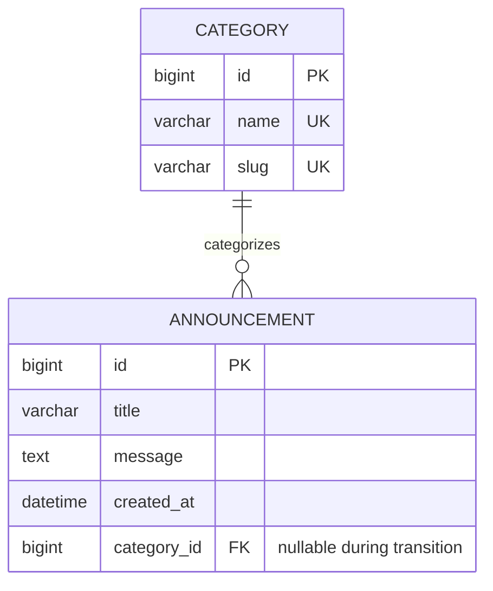
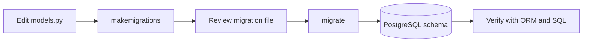

# DBAS 3200 — Workshop 05: Django Models, Relationships & Migrations

**Course:** DBAS 3200 — Data-Driven Application Programming  
**Instructor:** Davis Boudreau  
**Semester:** Fall 2026  
**Workshop:** WS05  
**Type:** Self-guided, hands-on workshop  
**Estimated time:** 5–7 hours (plus optional extension)  
**Environment:** The existing `myapp` Django 5.2 / PostgreSQL 16 project running through Docker Compose from WS03, with SQL/ORM experience from WS04  
**Assessment:** Workshop category, subject to the published course evaluation scheme  
**Preparation for:** Milestone 1 — Database Design & Data Access Foundation

---

## 1. Overview

### Purpose

In WS03 you built a Dockerized Django application and connected it to PostgreSQL. In WS04 you explored common SQL operations and their Django ORM equivalents using an `Announcement` model. In WS05 you will **turn a single-table application into a relational application** by introducing a `Category` model and linking announcements to categories.

You will design the relationship, change the Django models, generate and inspect migrations, populate related records, compare SQL JOINs with Django ORM queries, and verify that the database enforces the intended relationships. You will work in the existing project rather than creating a new application.

### Why this matters

Real applications contain related information: customers and orders, departments and employees, events and registrations, or categories and announcements. Relational modeling reduces duplication and helps maintain data integrity. Migrations make schema changes repeatable and reviewable across development environments.

### Learning objectives

By the end of this workshop, you should be able to:

1. Distinguish entities, attributes, primary keys, foreign keys, and cardinality.
2. Explain and sketch a one-to-many entity relationship.
3. Implement Django models with appropriate field types and constraints.
4. Add a relationship to an existing table without losing current records.
5. Generate, inspect, apply, and verify Django migrations.
6. Create and retrieve related objects using the Django ORM.
7. Compare a PostgreSQL `INNER JOIN` and `LEFT JOIN` with ORM relationship queries.
8. Explain referential integrity, deletion behavior, and query efficiency.
9. Document schema changes, tests, and troubleshooting evidence in GitHub.

### Learning outcomes addressed

- **LO1:** Implement a data access layer using an ORM.
- **LO2:** Manage the application's PostgreSQL database connection and schema lifecycle.
- **LO3:** Use a language-specific data access interface to retrieve related data.
- **LO4:** Create, retrieve, and manipulate related application data.
- **Professional practice:** Use Git, documentation, verification, and reflective troubleshooting.

> **Scope:** Transaction management with `transaction.atomic()` is reserved for a later workshop. This workshop introduces database integrity and safe schema changes, not full transaction design.

---

## 2. Before you begin — readiness check

### What you need

- Docker Desktop with WSL integration (Windows), or an equivalent working Docker Engine/Compose installation.
- VS Code connected to the project environment.
- A working `myapp` repository containing `compose.yaml`, `Dockerfile`, `manage.py`, `config/`, `core/`, and `templates/`.
- A working PostgreSQL service and existing `core.Announcement` model with `title`, `message`, and `created_at` fields.
- A configured local `.env` file that is excluded from Git.

### Task 2.1 — verify the application

From the **project root** (the directory containing `compose.yaml`):

```bash
docker compose up -d --build
docker compose ps
docker compose exec web python manage.py check
docker compose exec web python manage.py showmigrations core
```

Open <http://localhost:8000> and confirm that the WS03/WS04 application still works.

**Checkpoint 1 — record in your worksheet:** What is the status of each container? Does Django report any system-check issues? What migrations are already applied for `core`?

### Task 2.2 — protect your existing work

```bash
git status
git add .
git commit -m "Checkpoint before WS05 model changes"
```

If there are no changes, Git may report *nothing to commit*; that is fine. Confirm that your work is already pushed to GitHub. **Do not run `docker compose down -v`**: the `-v` option removes the named PostgreSQL volume and can delete your database records.

---

## 3. Concepts and theory — from one table to related tables

### 3.1 Entities and attributes

An **entity** is a type of thing the application stores (for example, `Category` or `Announcement`). An **attribute** is a property of that entity (for example, `name` or `title`). A **primary key (PK)** uniquely identifies a row. A **foreign key (FK)** references a row in another table.

In WS04, every announcement was independent. We now want each announcement to **optionally belong to one category**, while one category may have many announcements. Allowing the category to be empty is intentional: it lets us preserve existing WS03/WS04 announcements while evolving the schema.

### 3.2 Relationship diagram



**Read the diagram:** A category may have zero or many announcements. An announcement may have zero or one category during this workshop's transition. A category's `id` is stored in `core_announcement.category_id`.

### 3.3 Primary key versus foreign key

| Concept | Example | Purpose |
|---|---|---|
| Primary key | `core_category.id` | Uniquely identifies a category |
| Foreign key | `core_announcement.category_id` | Links an announcement to a category |
| Unique constraint | `Category.slug` | Prevents duplicate category slugs |
| Nullability | `category = null` | Permits older announcements to remain uncategorized |
| Deletion policy | `on_delete=PROTECT` | Prevents deleting a category still referenced by announcements |

### 3.4 Django migration lifecycle



`makemigrations` **creates migration files** describing model changes; `migrate` **applies** unapplied migrations to the database. Migration files belong in Git. Database contents and local `.env` files do not.

### Prior knowledge check — answer before coding

1. If two announcements belong to the same category, should the category name be duplicated in both announcement rows? Why or why not?
2. What might happen if you add a new required foreign key to a table that already contains rows?
3. Why might an application choose `PROTECT` instead of deleting all related announcements when a category is deleted?

---

## 4. Guided activity A — design the relationship

**What:** Extend the current data model with a `Category` entity.  
**Why:** Store category information once and associate many announcements with it.  
**How:** Before editing code, draw or copy the ERD from Section 3.2 into your worksheet and annotate:

- Which table owns the foreign key?
- Which relationship is one-to-many?
- Why is `category_id` initially nullable?
- What should happen if someone tries to delete a category that still has announcements?

**Checkpoint 2:** Explain your ERD to another student or in writing. Use the terms *entity*, *primary key*, *foreign key*, and *cardinality* correctly.

---

## 5. Guided activity B — extend the Django models

### Task 5.1 — inspect the current model

Open `core/models.py`. Confirm that your existing `Announcement` model has fields equivalent to the following:

```python
class Announcement(models.Model):
    title = models.CharField(max_length=120)
    message = models.TextField()
    created_at = models.DateTimeField(auto_now_add=True)

    def __str__(self):
        return self.title
```

If you customized your model in WS04, preserve those changes and adapt the following steps rather than replacing the file blindly.

### Task 5.2 — add `Category` and the foreign key

Update `core/models.py` to include:

```python
from django.db import models


class Category(models.Model):
    name = models.CharField(max_length=80, unique=True)
    slug = models.SlugField(max_length=80, unique=True)

    class Meta:
        ordering = ["name"]
        verbose_name_plural = "categories"

    def __str__(self):
        return self.name


class Announcement(models.Model):
    title = models.CharField(max_length=120)
    message = models.TextField()
    created_at = models.DateTimeField(auto_now_add=True)
    category = models.ForeignKey(
        Category,
        on_delete=models.PROTECT,
        related_name="announcements",
        null=True,
        blank=True,
    )

    def __str__(self):
        return self.title
```

**Understand the design:**

- `unique=True` prevents duplicate category names and slugs.
- `SlugField` stores a URL-friendly identifier such as `course-news`.
- `related_name="announcements"` lets you query `category.announcements.all()`.
- `null=True` allows existing database rows to remain valid while we introduce categories.
- `blank=True` allows the category to be omitted in Django forms and validation.
- `on_delete=models.PROTECT` blocks category deletion while dependent announcements exist. This is an application-level Django deletion policy; do not assume it is identical to every database-level `ON DELETE` behavior.

### Task 5.3 — check the model definitions

```bash
docker compose exec web python manage.py check
```

**Checkpoint 3:** Record one difference between `null=True` and `blank=True`, and explain why we used both here.

---

## 6. Guided activity C — create and apply migrations

### Task 6.1 — generate a migration

```bash
docker compose exec web python manage.py makemigrations core
```

Expected changes: creation of the `Category` table and addition of a nullable `category` field to `Announcement`. Your migration number may differ from examples because it depends on earlier workshops.

### Task 6.2 — inspect the generated migration

Open the new file in `core/migrations/`. Look for operations similar to `CreateModel` and `AddField`. Record the generated filename in your worksheet.

Inspect the SQL that Django plans to execute, replacing `0002` with **your actual migration number**:

```bash
docker compose exec web python manage.py sqlmigrate core 0002
```

Look for `CREATE TABLE`, `ALTER TABLE`, and the foreign-key column. The exact SQL depends on your database and migration history.

### Task 6.3 — apply the migration

```bash
docker compose exec web python manage.py migrate
docker compose exec web python manage.py showmigrations core
```

An `[X]` beside a migration means Django has recorded it as applied.

### Task 6.4 — verify the PostgreSQL schema

```bash
docker compose exec db sh -c \
'psql -U "$POSTGRES_USER" -d "$POSTGRES_DB" -c "\d core_category"'

docker compose exec db sh -c \
'psql -U "$POSTGRES_USER" -d "$POSTGRES_DB" -c "\d core_announcement"'
```

Confirm that `core_category` exists and that `core_announcement` includes `category_id`.

**Checkpoint 4:** Capture the migration filename, applied status, and one PostgreSQL schema observation. Explain the difference between `makemigrations` and `migrate`.

---

## 7. Guided activity D — create related records using the ORM

### Task 7.1 — enter the Django shell

```bash
docker compose exec web python manage.py shell
```

### Task 7.2 — create categories

```python
from core.models import Announcement, Category

news, _ = Category.objects.get_or_create(
    slug="course-news",
    defaults={"name": "Course News"},
)

labs, _ = Category.objects.get_or_create(
    slug="lab-updates",
    defaults={"name": "Lab Updates"},
)

print(list(Category.objects.values("id", "name", "slug")))
```

`get_or_create()` makes this exercise easier to repeat without creating duplicate categories.

### Task 7.3 — add announcements

```python
Announcement.objects.create(
    title="WS05 is ready",
    message="We are learning relational modeling.",
    category=labs,
)

Announcement.objects.create(
    title="Milestone 1 planning",
    message="Start thinking about entities and relationships.",
    category=news,
)
```

### Task 7.4 — associate an existing announcement

```python
existing = Announcement.objects.filter(category__isnull=True).first()

if existing:
    existing.category = news
    existing.save(update_fields=["category"])
    print("Updated:", existing.title)
else:
    print("No uncategorized announcement found; no update needed.")
```

### Task 7.5 — query from both directions

```python
# Forward relationship: announcement -> category
for announcement in Announcement.objects.select_related("category"):
    category_name = announcement.category.name if announcement.category else "Uncategorized"
    print(announcement.title, "->", category_name)

# Reverse relationship: category -> announcements
for announcement in labs.announcements.all():
    print("Lab update:", announcement.title)
```

Exit the shell with `exit()`.

**Checkpoint 5:** Record the output of one forward relationship query and one reverse relationship query. Explain what `related_name` changes.

---

## 8. Guided activity E — compare SQL JOINs and Django ORM

### Task 8.1 — execute an INNER JOIN in PostgreSQL

```bash
docker compose exec db sh -c \
'psql -U "$POSTGRES_USER" -d "$POSTGRES_DB" -c "SELECT a.id, a.title, c.name AS category FROM core_announcement AS a INNER JOIN core_category AS c ON a.category_id = c.id ORDER BY a.id;"'
```

An `INNER JOIN` returns announcements **with matching categories**. Announcements whose `category_id` is `NULL` do not appear.

### Task 8.2 — execute a LEFT JOIN

```bash
docker compose exec db sh -c \
'psql -U "$POSTGRES_USER" -d "$POSTGRES_DB" -c "SELECT a.id, a.title, c.name AS category FROM core_announcement AS a LEFT JOIN core_category AS c ON a.category_id = c.id ORDER BY a.id;"'
```

A `LEFT JOIN` preserves **all announcements**, including those without a category. The category columns for unmatched rows are `NULL`.

### Task 8.3 — retrieve the same information with Django ORM

```bash
docker compose exec web python manage.py shell
```

```python
from core.models import Announcement

# INNER JOIN-style result: only categorized announcements
categorized = Announcement.objects.filter(
    category__isnull=False
).select_related("category")

for item in categorized:
    print(item.title, "->", item.category.name)

# LEFT JOIN-style result: all announcements, even uncategorized
all_items = Announcement.objects.select_related("category")

for item in all_items:
    print(item.title, "->", item.category.name if item.category else None)

# Inspect SQL generated by Django
print(categorized.query)
print(all_items.query)
```

**Important:** ORM methods express *query intent*. `select_related()` can use a SQL join, but the exact generated join type depends on model nullability and query conditions. Inspect `query` rather than assuming a fixed SQL statement.

### Task 8.4 — filter by a related field

```python
lab_items = Announcement.objects.filter(category__slug="lab-updates")
print(list(lab_items.values_list("title", flat=True)))
```

Exit with `exit()`.

**Checkpoint 6 — SQL vs ORM comparison:**

| Question | SQL observation | ORM observation |
|---|---|---|
| Which records appear with INNER JOIN-style filtering? | Record results | Record results |
| Which records appear when unmatched announcements are preserved? | Record results | Record results |
| How is a relationship specified? | `ON a.category_id = c.id` | `category` / `category__...` |
| How can you inspect the ORM's SQL? | N/A | `print(queryset.query)` |

---

## 9. Guided activity F — display related data in a Django template

**What:** Update the existing homepage to show each announcement's category.  
**Why:** Connect database relationships to a visible application result.

### Task 9.1 — update the view

In `core/views.py`, adapt the existing home view:

```python
from django.shortcuts import render
from .models import Announcement


def home(request):
    announcements = Announcement.objects.select_related("category").order_by(
        "-created_at"
    )
    return render(
        request,
        "home.html",
        {
            "message": "Announcements and their categories",
            "announcements": announcements,
        },
    )
```

Preserve any other views your project already contains.

### Task 9.2 — update the template

In the existing `templates/home.html`, retain its `` and content block. Within the content block, display:

```html
<h2>Announcements</h2>


  <article>
    <h3>{{ announcement.title }}</h3>
    <p>{{ announcement.message }}</p>
    <p>
      <strong>Category:</strong>
      
        {{ announcement.category.name }}
      
        Uncategorized
      
    </p>
  </article>

  <p>No announcements found.</p>

```

Do not paste a second `` inside an existing block. Merge the snippet into the current template structure.

### Task 9.3 — verify

```bash
docker compose exec web python manage.py check
docker compose logs --tail=30 web
```

Open <http://localhost:8000> and confirm categories appear beside the correct announcements. Check that older uncategorized records still display without causing errors.

**Checkpoint 7:** Capture a screenshot or describe the browser result and explain how the template accesses `announcement.category.name`.

---

## 10. Guided activity G — investigate constraints and deletion behavior

### Task 10.1 — predict before testing

In your worksheet, predict what will happen if you:

1. Try to create a second category with the same `slug`.
2. Try to delete a category that still has announcements.
3. Attempt to assign an announcement to a nonexistent category ID.

### Task 10.2 — test the unique constraint safely

```bash
docker compose exec web python manage.py shell
```

```python
from django.db import IntegrityError
from core.models import Category

try:
    Category.objects.create(name="Duplicate Lab", slug="lab-updates")
except IntegrityError as error:
    print("Expected unique-constraint failure:", type(error).__name__)
```

The database should reject the duplicate `slug`. The test is wrapped in an exception handler so the error can be examined without ending the exercise.

### Task 10.3 — test protected deletion

```python
from django.db.models.deletion import ProtectedError

labs = Category.objects.get(slug="lab-updates")

try:
    labs.delete()
except ProtectedError:
    print("Deletion blocked: announcements still reference this category.")
```

Do **not** remove related announcements simply to make the category delete succeed. We are verifying protection, not deleting workshop data.

### Task 10.4 — verify referential integrity

Use the SQL console to inspect foreign-key information:

```bash
docker compose exec db sh -c \
'psql -U "$POSTGRES_USER" -d "$POSTGRES_DB" -c "\d core_announcement"'
```

Observe the foreign-key constraint. You do not need to insert invalid foreign keys to prove the constraint exists.

Exit the Python shell with `exit()`.

**Checkpoint 8:** Explain which protections come from database constraints and which come from Django's model/deletion behavior.

---

## 11. Guided activity H — inspect query efficiency

When a page displays many announcements and accesses `announcement.category`, Django may otherwise perform additional database queries for related objects. `select_related("category")` retrieves the foreign-key relationship in the initial query.

### Task 11.1 — compare query counts

```bash
docker compose exec web python manage.py shell
```

```python
from django.db import connection, reset_queries
from django.conf import settings
from core.models import Announcement

print("DEBUG enabled:", settings.DEBUG)

reset_queries()
for item in Announcement.objects.all():
    _ = item.category.name if item.category else None
print("Without select_related:", len(connection.queries))

reset_queries()
for item in Announcement.objects.select_related("category"):
    _ = item.category.name if item.category else None
print("With select_related:", len(connection.queries))
```

This diagnostic depends on Django's query logging, which is generally enabled when `DEBUG=True`. The exact counts depend on your data and environment. If all announcements are uncategorized, the comparison may not demonstrate additional related-object queries; ensure at least two categorized announcements exist.

**Checkpoint 9:** Record the two counts and explain the **N+1 query problem** in your own words.

---

## 12. Workshop challenge — analyze and apply

**Scenario:** A college application stores departments and employees. One department may have many employees, but an employee belongs to one department. The system must not allow a department to be deleted while employees are assigned to it.

Without writing a complete second application:

1. Sketch an ERD for `Department` and `Employee`.
2. Identify the PK and FK.
3. Write a Django `ForeignKey` definition with an appropriate `on_delete` behavior.
4. Write a SQL `INNER JOIN` that returns employee names and department names.
5. Write an ORM query that retrieves employees with their department names efficiently.
6. Explain what you would do if an existing `Employee` table already contained rows before adding the foreign key.

Discuss your design with a peer or record your reasoning in the worksheet. This challenge previews Milestone 1, where you will choose the entities and relationships for your own application.

---

## 13. Troubleshooting reference

| Symptom | Likely cause | Investigation / corrective action |
|---|---|---|
| `No changes detected` | Model not saved, wrong app, or changes already migrated | Inspect `core/models.py`, `INSTALLED_APPS`, and migration history |
| `relation "core_category" does not exist` | Migration not applied | `python manage.py showmigrations core` and `migrate` |
| Migration asks for a default | Added a non-null field to existing rows | Use a deliberate staged migration strategy; do not invent a destructive default |
| `IntegrityError` on category slug | Duplicate unique value | Choose a new slug or use `get_or_create()` |
| `ProtectedError` on delete | Category has dependent announcements | Keep the category or plan an intentional reassignment strategy |
| Template raises an attribute error | Missing category or wrong variable | Check `if announcement.category` and view context |
| Slow related-object rendering | Repeated relationship queries | Use `select_related()` for foreign-key access |
| Docker web container not running | Service error | `docker compose ps` and `docker compose logs web` |
| Database connection failure | PostgreSQL unhealthy or config mismatch | `docker compose ps`, `docker compose logs db`, `.env` |

**Professional debugging sequence:** Observe → Reproduce → Read error → Form hypothesis → Test one change → Verify → Document.

---

## 14. Reflection questions

Complete these in your **WS05 Workshop Worksheet**.

1. What is the difference between a primary key and a foreign key?
2. Why does `Announcement` contain `category_id` rather than repeating the category name?
3. Why did we initially allow the new foreign key to be `NULL`?
4. What is the difference between `makemigrations` and `migrate`?
5. What is the difference between an `INNER JOIN` and a `LEFT JOIN` in this project?
6. How does Django's `related_name` improve reverse queries?
7. Why did we use `on_delete=models.PROTECT`?
8. What did the unique-constraint test reveal about database integrity?
9. What problem does `select_related()` help prevent?
10. Which parts of WS05 will you reuse when designing your own Milestone 1 database?

---

## 15. Student deliverables & submission guidelines

All students complete the **Workshop 05 Worksheet** during the activities, recording predictions, observations, SQL/ORM results, migration evidence, debugging findings, and reflections. Students attending the in-class workshop complete the worksheet and participate in the instructor-led class review at the end; **they do not submit the worksheet unless separately directed**.

Students absent from the in-class workshop must complete the entire workshop independently and **submit their fully completed worksheet to Brightspace**. The worksheet should contain enough evidence for the instructor to verify the work without attending the class session.

All students complete the technical exercises, commit and push their changes to GitHub, and maintain a README with the relationship design, migration instructions, verification results, and any troubleshooting notes. Do not commit `.env`, passwords, or database volumes.

### GitHub evidence

Update `README.md` with a **WS05 — Models, Relationships & Migrations** section containing:

- A diagram or concise description of the Category–Announcement relationship.
- The new migration filename and steps to apply it.
- One SQL JOIN and its Django ORM equivalent.
- A summary of integrity checks and query-efficiency findings.
- A screenshot or written verification of the updated home page.

Then run:

```bash
git status
git add core/models.py core/migrations/ core/views.py templates/home.html README.md
git commit -m "WS05 add category relationships and verify migrations"
git push
```

If your template path or other files differ, adjust the `git add` command accordingly. Confirm that `.env` remains ignored.

---

## 16. Evaluation criteria — A/P/T/F/R

| Criterion | Evidence of learning |
|---|---|
| **A — Attendance** | Participates in the scheduled workshop or completes the absent-student workflow |
| **P — Participation** | Explains relationship design, discusses predictions, and reviews results |
| **T — Task Progress** | Implements models, migrations, ORM relationships, JOIN queries, and template output |
| **F — Focus & Professional Conduct** | Uses safe migrations, protects existing data, troubleshoots methodically, and commits appropriate files |
| **R — Reflection / Exit Evidence** | Completes worksheet questions, verifies checkpoints, and explains Milestone 1 readiness |

The workshop contributes to the workshop assessment category according to the published Fall 2026 evaluation scheme.

---

## 17. Completion checklist

- [ ] WS03 Docker/Django/PostgreSQL stack is running.
- [ ] Existing data was preserved before schema changes.
- [ ] Category–Announcement ERD is understood and documented.
- [ ] `Category` model and `Announcement.category` foreign key are implemented.
- [ ] Migration was generated, inspected, and applied.
- [ ] PostgreSQL tables and foreign-key column were verified.
- [ ] Related records were created and retrieved through Django ORM.
- [ ] SQL `INNER JOIN` and `LEFT JOIN` results were compared.
- [ ] Home page displays category names safely.
- [ ] Unique constraint and protected deletion were tested.
- [ ] Query efficiency was investigated using `select_related()`.
- [ ] Workshop challenge and reflections were completed.
- [ ] README and GitHub repository were updated.
- [ ] Worksheet submission rules were followed.

---

## 18. Looking ahead — Milestone 1

WS05 provides a **guided reference implementation**. In **Milestone 1 — Database Design & Data Access Foundation**, you will apply these same techniques to **your own semester application**. You should be prepared to identify at least three meaningful entities, design appropriate relationships, implement Django models and migrations, and demonstrate successful data creation and retrieval through the ORM.

Your Milestone 1 design should reflect a real application domain rather than copying `Category` and `Announcement` without justification. You are **not yet required to build a complete CRUD user interface**; that will be developed in a subsequent workshop and milestone.

### References

- [Django 5.2 — Models](https://docs.djangoproject.com/en/5.2/topics/db/models/)
- [Django 5.2 — Migrations](https://docs.djangoproject.com/en/5.2/topics/migrations/)
- [Django 5.2 — QuerySets](https://docs.djangoproject.com/en/5.2/ref/models/querysets/)
- [Django 5.2 — Relationships](https://docs.djangoproject.com/en/5.2/topics/db/examples/many_to_one/)
- [PostgreSQL — JOIN Queries](https://www.postgresql.org/docs/current/queries-table-expressions.html)
- [Docker Compose documentation](https://docs.docker.com/compose/)
