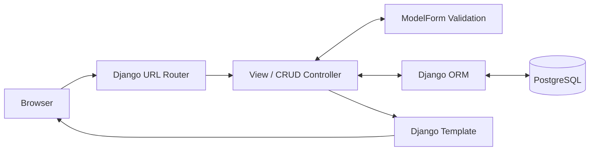

# DBAS 3200 — Workshop 06: Building a Complete Django CRUD Application

**Fall 2026 | Self-Guided Workshop | Django + PostgreSQL + Docker Compose**

## Workshop Details

| Field | Details |
|---|---|
| Course | DBAS 3200 — Data-Driven Application Programming |
| Workshop | WS06 — Building a Complete Django CRUD Application |
| Instructor | Davis Boudreau |
| Duration | Approximately 8–10 hours (adjust to class schedule) |
| Environment | Existing `myapp` project from WS03–WS05; Docker Compose services `web` and `db` |
| Assessment | Workshop learning evidence; apply the approved Fall 2026 evaluation scheme |
| Prerequisites | WS03 Dockerized Django/PostgreSQL, WS04 SQL and ORM, WS05 models/relationships/migrations |
| Primary outcomes | LO1 Data Access Layer; LO3 language-specific database interface; LO4 data manipulation |
| Supporting outcomes | LO2 connection management; LO5 transaction awareness; professionalism, documentation, portfolio |

> **Workshop progression:** Understand → Predict → Implement → Test → Debug → Improve → Commit → Reflect.
>
> **Important:** This workshop extends your existing repository and PostgreSQL database. Do not start a new Django project, reset the database, or run `docker compose down -v`.

## 1. Purpose and learning objectives

In WS03, you created a Dockerized Django/PostgreSQL application. In WS04, you explored SQL and the Django ORM. In WS05, you implemented related models and migrations. **Now you will turn those foundations into a working application that lets a user create, read, update, and delete records through HTML forms.**

By the end, you will be able to:

1. Explain the path from a browser request through a Django URL, view, form, ORM, and PostgreSQL.
2. Build and reuse Django templates for list, detail, create, update, and delete operations.
3. Use a `ModelForm` to validate user input before saving to PostgreSQL.
4. Implement CRUD views using Django's generic class-based views.
5. Handle HTTP GET versus POST and apply CSRF protection to forms.
6. Verify referential integrity when an `Announcement` belongs to a `Category`.
7. Write automated tests for CRUD behaviour, validation, and protected operations.
8. Record troubleshooting evidence and commit a reproducible solution to GitHub.

### How this workshop supports the semester project

The `Announcement` and `Category` models are a **guided practice application**. Your semester project may use different entities. The same CRUD patterns will transfer to your Milestone 2 implementation. Milestone 1 remains focused on the independent design and implementation of your own database foundation.

## 2. Architecture: browser to PostgreSQL



**Discuss and predict:** What should happen when a user submits a blank title? What should happen when a user requests to delete an announcement using only a GET request? Why should an application validate input even when the database has constraints?

### CRUD and HTTP

| Operation | User action | Typical HTTP request | Django tool | Database effect |
|---|---|---|---|---|
| Create | Submit a new announcement | `POST` | `CreateView` + `ModelForm` | `INSERT` |
| Read list | Browse announcements | `GET` | `ListView` | `SELECT` |
| Read detail | View one announcement | `GET` | `DetailView` | `SELECT ... WHERE` |
| Update | Submit edited fields | `POST` | `UpdateView` + `ModelForm` | `UPDATE` |
| Delete | Confirm removal | `POST` | `DeleteView` | `DELETE` |

**Safety principle:** Displaying a confirmation page (`GET`) must not delete a record. Deletion happens only after a valid `POST`.

## 3. Part A — Inspect and verify the existing project

Open the existing `myapp` repository in VS Code. From its root directory, verify the services:

```bash
docker compose up -d
docker compose ps
docker compose exec web python manage.py check
docker compose exec web python manage.py showmigrations
```

Inspect `core/models.py`. WS05 introduced a `Category` model and related it to `Announcement`. Your exact field names may differ. **Use the following as the reference contract for this workshop; adapt carefully if your WS05 implementation differs.**

```python
# core/models.py — reference model shape (do not duplicate existing classes)
from django.db import models


class Category(models.Model):
    name = models.CharField(max_length=80, unique=True)

    def __str__(self):
        return self.name


class Announcement(models.Model):
    category = models.ForeignKey(
        Category,
        on_delete=models.PROTECT,
        related_name="announcements",
    )
    title = models.CharField(max_length=120)
    message = models.TextField()
    created_at = models.DateTimeField(auto_now_add=True)

    def __str__(self):
        return self.title
```

If WS05 already defines these models, **keep your models and existing migrations**. If the model differs, reconcile the field names in subsequent examples. Do not replace models blindly or generate a migration that deletes existing data.

If you legitimately changed a model, inspect the generated migration before applying it:

```bash
docker compose exec web python manage.py makemigrations
docker compose exec web python manage.py sqlmigrate core <migration_number>
docker compose exec web python manage.py migrate
```

Replace `<migration_number>` with the generated migration number (for example `0003`). If there are no model changes, skip migration creation.

**Checkpoint A:** The application starts; both services are healthy; migrations are applied; existing announcements and categories are preserved. Record the results in your worksheet.

## 4. Part B — Create sample categories and announcements

A CRUD interface needs known test data. Use the Django shell to inspect the current records first:

```bash
docker compose exec web python manage.py shell
```

```python
from core.models import Category, Announcement

print(list(Category.objects.values_list("name", flat=True)))
print(Announcement.objects.count())

news, _ = Category.objects.get_or_create(name="News")
events, _ = Category.objects.get_or_create(name="Events")

if not Announcement.objects.filter(title="WS06 Welcome").exists():
    Announcement.objects.create(
        category=news,
        title="WS06 Welcome",
        message="We are building a complete CRUD interface.",
    )

print(list(Announcement.objects.values("id", "title", "category__name")))
exit()
```

**Predict:** Why is `get_or_create()` useful when a student repeats a setup exercise? Why do we check whether the announcement exists before inserting it?

**Checkpoint B:** You can identify at least one category and one announcement in PostgreSQL through the ORM.

## 5. Part C — Create a validated Django ModelForm

A `ModelForm` uses the Django model as the basis for form fields and validation. It reduces duplicate code but does not replace deliberate design of acceptable input.

Create `core/forms.py`:

```python
from django import forms
from .models import Announcement


class AnnouncementForm(forms.ModelForm):
    class Meta:
        model = Announcement
        fields = ["category", "title", "message"]
        widgets = {
            "message": forms.Textarea(attrs={"rows": 5}),
        }

    def clean_title(self):
        title = self.cleaned_data["title"].strip()
        if len(title) < 5:
            raise forms.ValidationError(
                "Title must contain at least 5 characters."
            )
        return title

    def clean_message(self):
        message = self.cleaned_data["message"].strip()
        if len(message) < 10:
            raise forms.ValidationError(
                "Message must contain at least 10 characters."
            )
        return message
```

### Validation layers

- **Browser validation:** Helpful immediate feedback, but users can bypass it.
- **Django form validation:** Rejects invalid input on the server before saving.
- **Model/database constraints:** Protect data integrity even when another code path writes to the database.

**Experiment:** Predict whether a title of `Hi` will save. Predict whether a message containing only spaces will save. Verify both in Part F.

## 6. Part D — Implement Django CRUD views

We will use Django's built-in generic class-based views. They are appropriate here because the application follows standard model-backed CRUD patterns. Students should still understand the underlying ORM operations.

Create or update `core/views.py` (preserve any existing views still needed by WS03–WS05):

```python
from django.db.models import ProtectedError
from django.http import HttpResponse
from django.urls import reverse_lazy
from django.views.generic import (
    CreateView,
    DeleteView,
    DetailView,
    ListView,
    UpdateView,
)

from .forms import AnnouncementForm
from .models import Announcement


class AnnouncementListView(ListView):
    model = Announcement
    template_name = "announcements/list.html"
    context_object_name = "announcements"

    def get_queryset(self):
        return Announcement.objects.select_related("category").order_by(
            "-created_at", "-pk"
        )


class AnnouncementDetailView(DetailView):
    model = Announcement
    template_name = "announcements/detail.html"
    context_object_name = "announcement"

    def get_queryset(self):
        return Announcement.objects.select_related("category")


class AnnouncementCreateView(CreateView):
    model = Announcement
    form_class = AnnouncementForm
    template_name = "announcements/form.html"
    success_url = reverse_lazy("announcement-list")


class AnnouncementUpdateView(UpdateView):
    model = Announcement
    form_class = AnnouncementForm
    template_name = "announcements/form.html"
    success_url = reverse_lazy("announcement-list")


class AnnouncementDeleteView(DeleteView):
    model = Announcement
    template_name = "announcements/confirm_delete.html"
    success_url = reverse_lazy("announcement-list")
```

**Note:** `ProtectedError` and `HttpResponse` are not needed in these views and can be omitted; they are introduced later in the optional relationship extension. The deletion view removes an **announcement**, not a category, so `Category`'s `PROTECT` rule does not block it.

### What the views do

| View | Important behaviour |
|---|---|
| `ListView` | Retrieves many announcements; `select_related()` loads category in the same query |
| `DetailView` | Retrieves one announcement or returns HTTP 404 if absent |
| `CreateView` | Displays an empty form on GET; validates and saves on POST |
| `UpdateView` | Displays populated form on GET; validates and updates on POST |
| `DeleteView` | Displays confirmation on GET; deletes only on POST |

**Checkpoint C:** Explain how `CreateView` ultimately produces an `INSERT` without a handwritten SQL statement.

## 7. Part E — Configure URLs

Create `core/urls.py`:

```python
from django.urls import path
from .views import (
    AnnouncementCreateView,
    AnnouncementDeleteView,
    AnnouncementDetailView,
    AnnouncementListView,
    AnnouncementUpdateView,
)

urlpatterns = [
    path("", AnnouncementListView.as_view(), name="announcement-list"),
    path("new/", AnnouncementCreateView.as_view(), name="announcement-create"),
    path("<int:pk>/", AnnouncementDetailView.as_view(), name="announcement-detail"),
    path("<int:pk>/edit/", AnnouncementUpdateView.as_view(), name="announcement-update"),
    path("<int:pk>/delete/", AnnouncementDeleteView.as_view(), name="announcement-delete"),
]
```

Update `config/urls.py`:

```python
from django.contrib import admin
from django.urls import include, path

urlpatterns = [
    path("admin/", admin.site.urls),
    path("announcements/", include("core.urls")),
]
```

If your earlier WS03 home page is still required, preserve its existing route alongside these routes rather than removing it. For example, retain `path("", home, name="home")` and import `home` from `core.views` if you kept that function.

**Checkpoint D:** Predict which URL should display the announcement list and which URL should display the edit form for record ID 1.

## 8. Part F — Build reusable templates

Ensure `config/settings.py` contains:

```python
# Within TEMPLATES[0]["DIRS"]:
"DIRS": [BASE_DIR / "templates"],
```

Create `templates/base.html` (or extend the existing file):

```html
<!DOCTYPE html>
<html lang="en">
<head>
    <meta charset="utf-8">
    <meta name="viewport" content="width=device-width, initial-scale=1">
    <title>myapp</title>
</head>
<body>
    <header>
        <h1>DBAS 3200 — myapp</h1>
        <nav>
            <a href="">Announcements</a>
            <a href="">New announcement</a>
        </nav>
    </header>
    <main>
        
    </main>
</body>
</html>
```

Create the directory `templates/announcements/` and the following four files.

### F1. `templates/announcements/list.html`

```html

Announcements

<h2>Announcements</h2>
<p><a href="">Create announcement</a></p>

  <article>
    <h3><a href="">{{ announcement.title }}</a></h3>
    <p>Category: {{ announcement.category.name }}</p>
    <p>{{ announcement.message|truncatewords:25 }}</p>
    <a href="">Edit</a>
    <a href="">Delete</a>
  </article>

  <p>No announcements yet.</p>


```

### F2. `templates/announcements/detail.html`

```html

{{ announcement.title }}

<article>
  <h2>{{ announcement.title }}</h2>
  <p>Category: {{ announcement.category.name }}</p>
  <p>{{ announcement.message }}</p>
  <p>Created: {{ announcement.created_at }}</p>
  <a href="">Edit</a>
  <a href="">Delete</a>
</article>

```

### F3. `templates/announcements/form.html`

```html

Announcement Form

<h2>EditCreate announcement</h2>
<form method="post">
  
  {{ form.non_field_errors }}
  
    <div>
      {{ field.label_tag }}
      {{ field }}
      {{ field.errors }}
      <small>{{ field.help_text }}</small>
    </div>
  
  <button type="submit">Save</button>
  <a href="">Cancel</a>
</form>

```

### F4. `templates/announcements/confirm_delete.html`

```html

Delete Announcement

<h2>Delete announcement?</h2>
<p>Are you sure you want to delete “{{ object.title }}”?</p>
<form method="post">
  
  <button type="submit">Yes, delete</button>
  <a href="">Cancel</a>
</form>

```

### Why `` matters

Django's CSRF middleware helps prevent another website from tricking an authenticated user's browser into submitting an unwanted state-changing request. A form that changes database records should use POST and include ``. CSRF protection is **not** a substitute for authentication and authorization; those are addressed in a later workshop.

## 9. Part G — Run the complete CRUD workflow

Check the application:

```bash
docker compose exec web python manage.py check
docker compose logs --tail=30 web
```

Open **http://localhost:8000/announcements/**.

Complete each task in order, recording evidence in the worksheet:

| Test | Action | Expected result |
|---|---|---|
| READ list | Open `/announcements/` | Existing announcements and categories appear |
| READ detail | Select a record | Correct title, message, and category appear |
| CREATE valid | Submit a new title (5+ chars), message (10+ chars), category | Redirect to list; new record appears |
| CREATE invalid | Submit title `Hi` | Form shows validation error; no new record saved |
| UPDATE valid | Edit a record | Saved changes appear in list/detail |
| UPDATE invalid | Replace message with `x` | Form error; previous stored message remains |
| DELETE GET | Open deletion confirmation URL | Record still exists |
| DELETE POST | Confirm deletion | Record disappears from list and database |
| 404 | Request `/announcements/999999/` | Not-found response (assuming ID absent) |
| Persistence | `docker compose down`, then `docker compose up -d` | Remaining records are preserved |

**Challenge:** Try submitting only spaces as a message. What happens and which part of the code is responsible?

## 10. Part H — Verify operations against PostgreSQL

Use the Django shell:

```bash
docker compose exec web python manage.py shell
```

```python
from core.models import Announcement

print(Announcement.objects.count())
print(list(Announcement.objects.values("id", "title", "category__name")))
exit()
```

Then query PostgreSQL directly (the credentials are read inside the database container):

```bash
docker compose exec db sh -c \
'psql -U "$POSTGRES_USER" -d "$POSTGRES_DB" -c "SELECT id, title, category_id FROM core_announcement ORDER BY id;"'
```

**Compare:** Does the data shown in the browser match the ORM and SQL query results? Explain why these three views of the data should agree.

### SQL operations behind the scenes

| Browser action | Representative SQL | ORM mechanism |
|---|---|---|
| Browse list | `SELECT ... FROM core_announcement` | `ListView.get_queryset()` |
| View one | `SELECT ... WHERE id = ...` | `DetailView.get_object()` |
| Create | `INSERT INTO ...` | `ModelForm.save()` |
| Edit | `UPDATE ... WHERE id = ...` | `ModelForm.save()` |
| Delete | `DELETE FROM ... WHERE id = ...` | `DeleteView` |

These are **representative operations**, not exact generated SQL; Django may issue additional queries for relationships, validation, or transactions.

## 11. Part I — Automated tests

Manual testing is necessary, but professional application development also requires repeatable automated tests. Django's test runner uses a separate test database, so ordinary workshop data should not be modified by these tests.

Create or replace `core/tests.py`:

```python
from django.test import TestCase
from django.urls import reverse

from .models import Announcement, Category


class AnnouncementCrudTests(TestCase):
    @classmethod
    def setUpTestData(cls):
        cls.category = Category.objects.create(name="Workshop Tests")
        cls.announcement = Announcement.objects.create(
            category=cls.category,
            title="Original announcement",
            message="Original announcement message",
        )

    def test_list_displays_announcement(self):
        response = self.client.get(reverse("announcement-list"))
        self.assertEqual(response.status_code, 200)
        self.assertContains(response, "Original announcement")

    def test_create_valid_announcement(self):
        response = self.client.post(
            reverse("announcement-create"),
            {
                "category": self.category.pk,
                "title": "New announcement",
                "message": "A valid new message for testing",
            },
        )
        self.assertEqual(response.status_code, 302)
        self.assertTrue(
            Announcement.objects.filter(title="New announcement").exists()
        )

    def test_create_rejects_short_title(self):
        response = self.client.post(
            reverse("announcement-create"),
            {
                "category": self.category.pk,
                "title": "Hi",
                "message": "A valid message for testing",
            },
        )
        self.assertEqual(response.status_code, 200)
        self.assertContains(response, "at least 5 characters")
        self.assertFalse(Announcement.objects.filter(title="Hi").exists())

    def test_update_announcement(self):
        response = self.client.post(
            reverse("announcement-update", args=[self.announcement.pk]),
            {
                "category": self.category.pk,
                "title": "Updated announcement",
                "message": "Updated announcement message",
            },
        )
        self.assertEqual(response.status_code, 302)
        self.announcement.refresh_from_db()
        self.assertEqual(self.announcement.title, "Updated announcement")

    def test_get_delete_page_does_not_delete(self):
        response = self.client.get(
            reverse("announcement-delete", args=[self.announcement.pk])
        )
        self.assertEqual(response.status_code, 200)
        self.assertTrue(
            Announcement.objects.filter(pk=self.announcement.pk).exists()
        )

    def test_post_delete_removes_announcement(self):
        response = self.client.post(
            reverse("announcement-delete", args=[self.announcement.pk])
        )
        self.assertEqual(response.status_code, 302)
        self.assertFalse(
            Announcement.objects.filter(pk=self.announcement.pk).exists()
        )
```

Run:

```bash
docker compose exec web python manage.py test core
```

**Checkpoint E:** All six tests pass. If a test fails, identify the failing assertion, inspect the view/form/model, make one change, and rerun. Record the result.

**Note about test database permissions:** If PostgreSQL reports that the test database cannot be created, inspect the database user's privileges and consult your instructor. Do not run tests against the normal application database as a workaround.

## 12. Part J — Explore relationships and protected deletion

WS05 introduced `on_delete=models.PROTECT` for the relationship between `Announcement` and `Category`. This protects a category from deletion while announcements still reference it.

In the Django shell:

```python
from django.db.models import ProtectedError
from core.models import Category

category = Category.objects.get(name="News")
print(category.announcements.count())

try:
    category.delete()
    print("Category deleted because no protected announcements reference it.")
except ProtectedError:
    print("Deletion blocked: announcements still reference this category.")
```

**Important:** Only run this experiment against a category you are willing to delete. For a non-destructive test, create a dedicated category and a linked announcement first, then attempt to delete that category.

**Discussion:** Why is protected deletion different from deleting an individual announcement? What risks arise when deleting related records without understanding foreign keys?

## 13. Part K — Optional challenge: Query efficiency and user feedback

### Challenge 1 — Query efficiency

Remove `select_related("category")` temporarily from the list view. Investigate the difference in query count when displaying multiple announcements, then restore it. You may use `django.db.connection.queries` in a local debug session or Django Debug Toolbar if your instructor approves. Explain the N+1 query problem.

### Challenge 2 — Confirmation messages

Use Django's messages framework to display a success message after creating or updating an announcement. Keep the behaviour accessible and do not expose internal database errors to end users.

### Challenge 3 — Category CRUD design

Sketch the views, URLs, forms, and templates required to manage categories. Explain how you would handle a category deletion rejected by `PROTECT`. This is a design exercise; a complete category CRUD interface is not required for WS06.

## 14. Troubleshooting reference

| Symptom | Likely cause | Check |
|---|---|---|
| `TemplateDoesNotExist` | Wrong path or template setting | `templates/announcements/` and `TEMPLATES[0]["DIRS"]` |
| `NoReverseMatch` | Incorrect URL name or missing argument | Compare `reverse()` and `` with `core/urls.py` |
| `OperationalError` | Database unavailable | `docker compose ps`; `docker compose logs db` |
| `ProgrammingError` about a column | Model and database schema differ | `showmigrations`, migration files, model definitions |
| `403 CSRF verification failed` | Missing CSRF token or middleware issue | ``, browser cookies, middleware |
| Form reappears without saving | Validation failed | Render `{{ field.errors }}` and inspect input |
| `IntegrityError` | Constraint or foreign-key violation | Inspect model and referenced category |
| Test database creation denied | PostgreSQL role lacks `CREATEDB` | Review database privileges with instructor |
| Browser shows old code | Wrong project, stale container, or file not saved | `docker compose logs web`, bind mount, current directory |

Useful diagnostics:

```bash
docker compose ps
docker compose logs --tail=50 web
docker compose exec web python manage.py check
docker compose exec web python manage.py showmigrations
docker compose exec web python manage.py test core
```

**Do not use** `docker compose down -v` to fix a routine error. It removes named volumes and can delete PostgreSQL data.

## 15. Student worksheet: required evidence

Complete the course worksheet during the workshop. Record:

1. **Predictions:** blank title, invalid message, GET deletion request, repeated setup.
2. **Environment:** Docker service status and Django system check.
3. **CRUD evidence:** one successful and one failed operation for Create and Update; successful Read and Delete.
4. **Database evidence:** ORM query output and matching PostgreSQL query output.
5. **Testing evidence:** automated test results and any debugging steps.
6. **Relationship evidence:** explanation of `PROTECT` and one safe investigation.
7. **Professional reflection:** design decisions, security practices, and next steps for the semester application.
8. **GitHub evidence:** repository URL and commit identifier.

### Reflection questions

1. How does a `ModelForm` reduce duplication between models, forms, and database operations?
2. What is the difference between a GET request and a POST request in this CRUD workflow?
3. Why must validation occur on the server even when the browser validates fields?
4. How does `` contribute to security, and what does it *not* protect against?
5. How do the Django ORM and PostgreSQL work together when creating or editing an announcement?
6. Why does `select_related()` matter when displaying a category for each announcement?
7. What happens when a category referenced by announcements is deleted with `PROTECT`?
8. How do automated tests improve reliability compared with manually clicking through the application?
9. Which part of this workshop would you reuse in your own semester project, and what would you change?
10. What error did you investigate, what evidence did you collect, and how did you resolve or explain it?

## 16. Student deliverables and submission guidelines

**Technical evidence (all students):** Commit and push your code to GitHub, including `core/forms.py`, views, URLs, templates, tests, and a README section describing how to run and test CRUD. Do not commit `.env`, passwords, or database dumps containing sensitive data.

**Worksheet (all students):** Complete the worksheet during the workshop. **In-class students** participate in the end-of-class review; the worksheet is not submitted unless the instructor directs otherwise. **Absent students** complete the workshop and worksheet independently and submit the completed worksheet to Brightspace. All students commit and push technical evidence.

Suggested commit workflow:

```bash
git status
git add core config templates README.md
git commit -m "WS06 implement validated Django CRUD interface and tests"
git push
```

If your existing project files use different paths, stage those files accordingly. Inspect `git status` before committing.

## 17. Evaluation: A / P / T / F / R

| Code | Criterion | Evidence |
|---|---|---|
| A | Attendance | Engagement in the scheduled workshop or approved alternative |
| P | Participation | Predictions, discussion, and guided investigations |
| T | Task Progress | Working CRUD interface, validation, relationship checks, tests |
| F | Focus & Professional Conduct | Safe database handling, debugging, source control, documentation |
| R | Reflection / Exit Evidence | Completed worksheet and GitHub evidence |

**Grading note:** The approved course evaluation scheme governs which workshops are graded and their weights. Do not assume WS06 is an additional 3% assessment without updating that scheme.

## 18. Completion checklist

- [ ] Existing WS03–WS05 application and PostgreSQL data preserved.
- [ ] Django model relationships and migrations verified.
- [ ] Sample data inspected and prepared safely.
- [ ] `AnnouncementForm` validates title and message.
- [ ] List and detail pages retrieve real PostgreSQL records.
- [ ] Create and update forms save valid data.
- [ ] Invalid data displays errors and is not saved.
- [ ] Delete requires confirmation and POST.
- [ ] ORM and direct SQL results agree.
- [ ] Six automated CRUD tests pass.
- [ ] Relationship protection investigated safely.
- [ ] README updated; GitHub changes committed and pushed.
- [ ] Worksheet and reflections completed.

## 19. Connection to Milestones 1 and 2

**Milestone 1 — Database Design & Data Access Foundation:** Independently define the semester application's entities, relationships, ERD, Django models, migrations, and basic ORM verification.

**Milestone 2 — Functional Data-Driven Application:** Reuse the WS06 CRUD pattern with the student's own models, forms, views, templates, validation, and tests. Add authentication/authorization and more advanced behaviour in subsequent instruction as required.

### Reference documentation

- Django generic editing views: https://docs.djangoproject.com/en/5.2/ref/class-based-views/generic-editing/
- Django ModelForms: https://docs.djangoproject.com/en/5.2/topics/forms/modelforms/
- Django form validation: https://docs.djangoproject.com/en/5.2/ref/forms/validation/
- Django testing: https://docs.djangoproject.com/en/5.2/topics/testing/
- Django CSRF protection: https://docs.djangoproject.com/en/5.2/howto/csrf/
- Docker Compose: https://docs.docker.com/compose/
