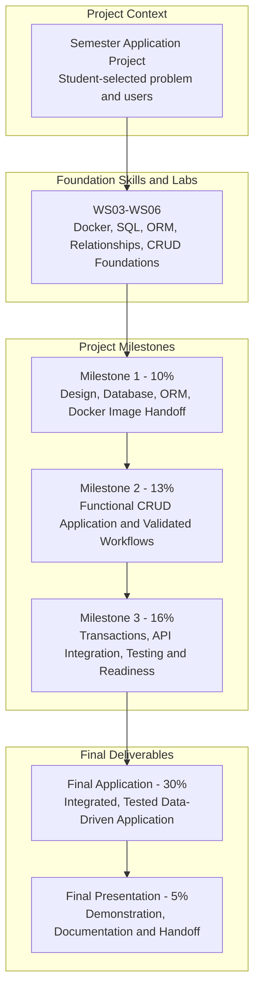
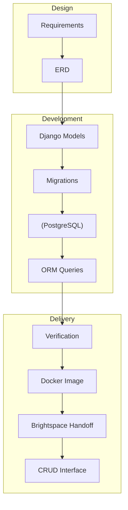
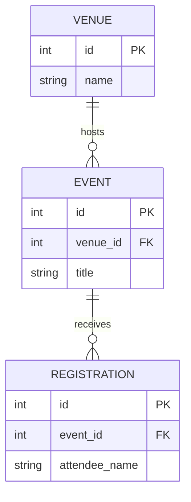
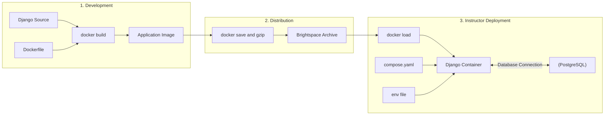

# DBAS 3200 — Milestone 1: Database Design & Data Access Foundation

**Semester Application Project — Student Assignment | Fall 2026**  
**Instructor:** Davis Boudreau  
**Assessment:** Milestone 1 — 10% of final course grade  
**Due date:** As posted in Brightspace  
**Delivery:** Individual semester application project; complete portable project package submitted to Brightspace

---

## 1. Assignment Details

| Field | Description |
|---|---|
| Course | DBAS 3200 — Data-Driven Application Programming |
| Assignment | Milestone 1 — Database Design & Data Access Foundation |
| Type | Independently developed semester project deliverable |
| Prior learning | WS01–WS06, especially WS03 Docker, WS04 SQL/ORM, WS05 models/relationships/migrations |
| Technology | Python, Django ORM, PostgreSQL, Docker Compose, Git/GitHub, VS Code |
| Weight | 10% |
| Submission | Project report (PDF or DOCX) to Brightspace; source code and documentation in GitHub |

## 2. Overview — Purpose and Why This Matters

Professional applications begin with a problem, a set of users, and reliable data requirements. The database is not merely a collection of tables: its structure determines which information can be stored, which relationships are valid, and whether the application can evolve safely.

**Your task is to design and implement the database foundation of your own semester-long application.** This is the first assessed project milestone, not a reproduction of the `myapp` workshop example. Your choices here will carry forward into later CRUD features, transactions, API development, testing, and final delivery.

**Learning progression:** Define → Analyze → Model → Implement → Migrate → Populate → Query → Verify → Document → Reflect.

### Success criteria

By the end of this assignment, you will have a credible application concept, a defensible ERD, at least three meaningfully related Django models, a working PostgreSQL schema, sample records, evidence of ORM access, and a reproducible, instructor-runnable project package.

## 3. DBAS 3200 — Semester Application Project & Milestone Roadmap

**One application. Three milestones. One final delivery.** You will design and develop a student-selected data-driven application across the semester. Each milestone extends the *same* PostgreSQL-backed Django application. Maintain version history with Git; package and submit an assessable snapshot for each milestone. Milestone 1 is a working **data foundation**, not a finished website.



| Stage | Assessment | Project deliverable | Boundary |
|---|---:|---|---|
| **Milestone 1** | **10%** | Defined problem; ERD; Django models; PostgreSQL migrations; ORM evidence; exported Docker image and source package | **Required now:** reproducible database foundation and image handoff; no complete UI or API required |
| Milestone 2 | 13% | Working application with Django views, templates, forms, validation and CRUD | Planned next project stage |
| Milestone 3 | 16% | Transactions, API capabilities, tests and operational improvements | Planned next project stage |
| Final Application | 30% | Integrated and tested application with documentation | Final product |
| Final Presentation | 5% | Demonstration and technical handoff | Explain and defend the work |

*The later milestone descriptions communicate the planned direction; their detailed requirements will be supplied in their own assignments.*

### How Milestone 1 contributes to the project



**What the instructor must be able to do:** inspect your project design and source, load your exported Django image, start the image alongside PostgreSQL with the supplied Compose configuration **without rebuilding**, apply migrations, reproduce sample data and ORM verification, and confirm persistence across a normal restart.

## 4. Learning Outcomes Addressed

This assignment primarily assesses the following course outcomes (use the approved course outline for authoritative wording):

- **LO1 — Data access layer:** Implement a database access layer using Django models and ORM.
- **LO2 — Connection management:** Configure and verify the application's PostgreSQL connection.
- **LO3 — Language-specific data interface:** Use Python and Django ORM to create and retrieve data.
- **LO4 — Data manipulation (foundational):** Populate and inspect related application records.
- **Professional practice:** Document decisions, use source control, and provide reproducible technical evidence.

**Not yet assessed in full:** complete CRUD user interfaces, application-level transactions, REST APIs, authentication, or deployment. These belong to subsequent milestones.

## 5. Prior Knowledge and Environment Readiness

Before designing your project, confirm you can:

- Open the existing Django project in VS Code and access its Git repository.
- Start the `web` and `db` services with Docker Compose.
- Explain the difference between a Django model, migration, ORM query, and PostgreSQL table.
- Create a model, apply a migration, and run an ORM query from the Django shell.
- Keep `.env` out of Git while tracking a safe `.env.example`.

**Readiness commands** (run from the directory containing `compose.yaml`):

```bash
docker compose up -d --build
docker compose ps
docker compose exec web python manage.py check
docker compose exec web python manage.py showmigrations
```

**Checkpoint 0:** Record the running service names, database engine, and current migration status. If the stack is not healthy, troubleshoot it before beginning project implementation.

## 6. Concepts and Theory — Design Before Coding

### 6.1 Application problem and scope

A useful project solves a specific problem for identifiable users. Define what the application will manage, who will use it, and which operations matter. A manageable scope is more valuable than a long feature list that cannot be completed.

### 6.2 Entities, attributes, and keys

An **entity** represents a business object (for example, an event, registration, or venue). **Attributes** describe that object. A **primary key** identifies a record; a **foreign key** links it to another record.

### 6.3 Relationships and cardinality

Use one-to-many and, where justified, many-to-many relationships. Explain whether a related record is required or optional and what should happen when a referenced record is deleted.

### 6.4 Data integrity and normalization

Choose appropriate data types, required/optional fields, uniqueness rules, and validation constraints. Avoid duplicating the same fact across several records when a relationship would represent it more reliably.

### 6.5 Django models, migrations, and ORM

Django models describe the schema in Python; migrations record schema changes; PostgreSQL stores the actual records; Django ORM provides a Python interface for querying them. A migration file is not evidence that the migration succeeded—verify the database state.

## 7. Project Challenge — Discuss and Analyze

**Scenario:** Your organization needs a new data-driven application. Stakeholders describe the problem informally, but there is no database design, documented business rule, or working prototype. You are responsible for proposing a feasible data foundation that other developers can understand and extend.

**Your challenge:** Design a project-specific relational schema and prove that Django can create and retrieve meaningful related data from PostgreSQL. The schema must be your own; do not simply rename the WS05 `Category` and `Announcement` example.

Possible domains include event management, equipment inventory, service requests, reservations, volunteer coordination, or another instructor-approved problem. Use **synthetic data**, not actual customer or student records.

**Think before coding:** Which entities are essential? Which facts belong in separate tables? Which relationships express real business rules? What would go wrong if you duplicated information or omitted a foreign key?

## 8. Phase A — Define Your Application

**What:** Write a concise project overview.  
**Why:** A database design must be justified by user and business needs.  
**How:** Describe the problem, intended users, application purpose, and boundaries.

**Required evidence:**

1. Project name and a one-paragraph problem statement.
2. Intended user roles or stakeholder groups.
3. **Three to five core use cases**, written as user goals.
4. Initial scope: what the first release will do and what is explicitly deferred.
5. At least **three business rules** that affect the data design.

**Checkpoint A:** Can another student explain your application's purpose and identify the information it must store without seeing your code?

## 9. Phase B — Analyze Data Requirements and Create an ERD

**What:** Translate the use cases into a relational design.  
**Why:** An ERD helps reveal missing relationships, duplicated attributes, and unclear business rules before migrations are created.  
**How:** Identify entities, fields, primary keys, foreign keys, and cardinalities.

**Minimum requirements:**

- **At least three meaningful related entities**; not three unrelated tables.
- A primary key for each entity.
- At least two documented relationships connecting the core entities.
- Appropriate field types and required/optional decisions.
- At least one meaningful integrity rule (for example, unique identifier, positive quantity, or protected relationship).
- Relationship labels/cardinalities and a short written explanation.

**Example of a relationship pattern, not a prescribed project schema:**



You may use Mermaid, diagrams.net, another ERD tool, or a clear hand-drawn diagram included in the report. The diagram must accurately match your implemented models.

**Checkpoint B:** For every relationship, explain its cardinality, foreign key location, and deletion behaviour. Verify that the three entities serve the project requirements rather than merely meeting a count.

## 10. Phase C — Implement Django Models and Constraints

**What:** Implement the approved design in the existing Dockerized Django project or a clearly documented project-specific Django app.  
**Why:** Models form the application's data access layer.  
**How:** Add model classes, fields, relationships, and constraints.

**Required implementation:**

- At least three project-specific Django models.
- Meaningful names and field types (`CharField`, `TextField`, `DateTimeField`, `DecimalField`, etc., as appropriate).
- Explicit `ForeignKey` or other justified relationships with appropriate `on_delete` behaviour.
- Useful `__str__()` methods.
- Required/optional field settings and at least one relevant uniqueness or validation constraint.
- A short explanation of the most important design decisions.

**Design check:** If a model changes, revisit the ERD and explain why. The final diagram and code must agree.

## 11. Phase D — Generate and Verify PostgreSQL Migrations

**What:** Apply your model definitions to PostgreSQL.  
**Why:** Migration files make schema evolution repeatable and auditable.  
**How:** Run and inspect Django migrations in the running `web` container.

```bash
docker compose exec web python manage.py makemigrations
docker compose exec web python manage.py migrate
docker compose exec web python manage.py showmigrations
docker compose exec web python manage.py check
docker compose exec web python manage.py makemigrations --check --dry-run
```

**Required evidence:** Commit the generated migration files and capture output showing that migrations applied successfully. The final dry-run check should not identify unapplied model changes.

**Checkpoint D:** Explain which PostgreSQL tables were created and how they correspond to your ERD. Verify the database connection uses the `db` Compose service inside Docker.

## 12. Phase E — Populate and Query Related Data

**What:** Create representative records and prove the relationships work.  
**Why:** A schema is only useful if the application can store and retrieve valid business information.  
**How:** Use Django shell, a documented seed script, or a Django management command.

Start the Django shell:

```bash
docker compose exec web python manage.py shell
```

**Illustrative ORM patterns** (replace placeholders with your own models and fields):

```python
# Import YOUR project's models.
# Create a parent record, then create a related child record.
# Retrieve all records for one model.
# Filter by a meaningful field.
# Traverse a ForeignKey relationship.
# Count or order a set of results.
```

**Minimum evidence:**

1. Several realistic, synthetic sample records across all three models.
2. At least one successful ORM **CREATE** operation.
3. At least two distinct ORM **READ** operations (for example, `.all()`, `.filter()`, `.order_by()`, or `.count()`).
4. At least one **related-object query** using a foreign-key traversal or related manager.
5. Results that demonstrate the records are stored in PostgreSQL, not merely displayed as hardcoded Python values.

**Checkpoint E:** Describe which SQL operation each ORM action represents. Show one record's relationship to a record in another table.

## 13. Phase F — Verify Persistence and Troubleshoot

**What:** Prove the application survives a normal Docker restart and that the project can be inspected by another developer.  
**Why:** Operational reliability is part of professional data-driven development.

```bash
docker compose down
docker compose up -d
docker compose ps
docker compose exec web python manage.py check
```

Repeat a read query and confirm your sample data still exists. **Do not use `docker compose down -v`** for this test: it removes named volumes and may delete PostgreSQL data.

**Troubleshooting reference:**

| Symptom | Investigate | Useful command |
|---|---|---|
| `web` or `db` not running | Service status and logs | `docker compose ps`; `docker compose logs db` |
| Database authentication error | `.env`, database initialization, credentials | `docker compose logs db` |
| Missing database table | Model and migration status | `python manage.py showmigrations` in `web` |
| Foreign key error | Related record and deletion rule | Inspect ORM operation and model relationship |
| Pending model changes | Migration files not generated | `makemigrations --check --dry-run` |
| Data disappears after restart | Volume configuration or accidental removal | `docker volume ls` and Compose volumes |

**Checkpoint F:** Record at least one diagnostic observation, the command used, and what the output established—even if no error occurred.

## 14. Phase G — Document, Commit, and Prepare Handoff

**What:** Make the project reproducible and reviewable.  
**Why:** The milestone is the foundation for subsequent project development and must be understandable to a future contributor.

Your submitted source package (and Git repository, if used) must include:

- Django application code and committed migration files.
- Dockerfile, `compose.yaml`, `requirements.txt`, and `.env.example`.
- `.gitignore` excluding `.env`, virtual environments, and other local secrets.
- README with purpose, prerequisites, setup, startup, migration, sample-data and verification instructions.
- ERD file or a link to the diagram; project report may also embed the diagram.
- A `.dockerignore` excluding `.env`, `.git`, local virtual environments and unnecessary files.
- Meaningful Git commits showing progress (retain locally or on a remote Git host).

Suggested final checks:

```bash
git status
git diff --check
git add .
git commit -m "Complete Milestone 1 data model and PostgreSQL foundation"
git push
```

Review staged files before committing. **Never commit `.env`, real credentials, private keys, database volume contents, or personal information.**

**Checkpoint G:** Could a classmate follow your README to reproduce your application and understand your database design?

## 15. Phase H — Build, Export, and Verify Your Docker Image

**What:** Turn your Django project into a distributable Docker image and prove that the exported image can be used for assessment.  
**Why:** An image packages application code and Python dependencies consistently. A container is a running instance of that image; a PostgreSQL named volume stores database records separately. A professional handoff must account for all three.  
**How:** Build, export, reload, and run your application image using the supplied Compose deployment instructions.

### 15.1 Understand what you are submitting



**Important:** The exported Django image does **not** contain your running PostgreSQL database or its persistent volume. Do not export the PostgreSQL image or the database volume. The instructor will initialize PostgreSQL using your Compose configuration and recreate the schema and synthetic sample data using your migrations and seed instructions.

### 15.2 Prepare a secure, portable image

Your `Dockerfile` should install dependencies from `requirements.txt` and copy the application source into the image. A production-grade web server is not required for this milestone; the existing Django development server is acceptable for local instructor verification only. Your `.dockerignore` must exclude `.env`, `.git`, `.venv`, `__pycache__`, local databases, and archives.

**Checkpoint H1:** Explain why `COPY . /app` without a proper `.dockerignore` could accidentally embed credentials in the image.

### 15.3 Build and inspect the image

From the project root:

```bash
docker build -t dbas3200-m1:1.0 .
docker image ls dbas3200-m1
```

**Checkpoint H2:** Record the image name, tag, image ID, size, and successful build output. Ensure the image actually contains your Django project, not just the workshop starter application.

### 15.4 Export the image for Brightspace

**Bash / WSL / Linux / macOS:**

```bash
docker save dbas3200-m1:1.0 | gzip > milestone1-image.tar.gz
```

**PowerShell (Windows):** Avoid piping Docker's binary image stream through a text-processing pipeline. Instead, use:

```powershell
docker save -o milestone1-image.tar dbas3200-m1:1.0
```

You may submit the uncompressed `.tar` file or compress it with an archive utility into `.tar.gz`. If using WSL Bash, the first command creates `.tar.gz` directly. Check the Brightspace upload limit before submission.

### 15.5 Prove the saved image can be loaded and run without rebuilding

Test the **actual exported artifact**, not only the image already present from your build. After saving the image, remove the *local image tag only when it is not in use*, or test on another Docker environment. Do not remove running containers or database volumes to force this check.

```bash
docker load -i milestone1-image.tar.gz
# If you exported an uncompressed archive, use:
# docker load -i milestone1-image.tar

docker image inspect dbas3200-m1:1.0
```

Create a deployment configuration named **`compose.assessment.yaml`**. It should define a PostgreSQL service and a Django service that uses the **saved image tag**, not a `build:` instruction. For example, the Django service should contain:

```yaml
services:
  web:
    image: dbas3200-m1:1.0
    # Retain the environment, ports, command and db dependency
    # appropriate to YOUR project, but omit build: and source bind mounts.
```

A source bind mount such as `.:/app` must **not** be used in `compose.assessment.yaml`: it can hide the application files packaged inside the image. The PostgreSQL service must have a named volume, and Django must connect to the service hostname `db`, not `localhost`. Provide an `.env.example` containing placeholders only; create a local `.env` with development-only values for your own test, but **do not submit `.env`**.

**Example instructor/student deployment commands:**

```bash
# First create your own .env from .env.example (do not submit it).
docker compose -f compose.assessment.yaml up -d --no-build
docker compose -f compose.assessment.yaml exec web python manage.py check
docker compose -f compose.assessment.yaml exec web python manage.py migrate
# Run YOUR documented seed/verification commands here.
docker compose -f compose.assessment.yaml ps
```

If your assessment Compose configuration uses `env_file: .env`, create `.env` locally first. An instructor must be able to substitute their own non-secret local development credentials. Ensure your `db` service and Django settings use matching database environment variables. Do **not** use `docker compose down -v` during a persistence test.

**Checkpoint H3:** Capture evidence that (a) the archive loads, (b) Compose starts using `image:` without a build or source mount, (c) migrations succeed, and (d) your sample data and ORM queries work against PostgreSQL.

### 15.6 Verify the handoff from the instructor's perspective

Your package should work with these actions: extract source package → create local `.env` from `.env.example` → load Django image → start assessment Compose without building → migrate → seed → verify queries. Document the **exact** commands and any platform assumptions in `README.md`.

**Troubleshooting:** If the image runs locally but fails in assessment mode, check for missing files in the image, source bind mounts, wrong `DB_HOST`, missing environment variables, architecture differences, and database startup readiness. Record the issue, evidence, and resolution.

**Checkpoint H4:** Could another person run the image without access to your development working directory, except for the provided Compose file and configuration? This is the standard for reproducibility.

## 16. Project Verification Checklist

- [ ] Project problem, users, scope, 3–5 use cases, and 3+ business rules are documented.
- [ ] ERD shows 3+ meaningful related entities, PKs, FKs, and cardinalities.
- [ ] Django models match the ERD and contain appropriate constraints.
- [ ] Migrations apply cleanly to PostgreSQL with no pending model changes.
- [ ] Reproducible synthetic seed data and CREATE, two READ, and related-object ORM queries work.
- [ ] PostgreSQL data survives a normal Compose restart.
- [ ] Docker image builds and the exported archive loads successfully.
- [ ] `compose.assessment.yaml` runs the loaded image **without** `build:` or a source bind mount.
- [ ] README documents load, configuration, startup, migration, seed, verification and shutdown.
- [ ] `.env`, secrets, volumes, personal data and local caches are absent from the submission.
- [ ] Brightspace contains the complete package, with consistent filenames and no missing dependencies.

## 17. Reflection and Project Decision Log

Answer briefly in the project report:

1. Which business rule most influenced your data model, and why?
2. Why did you choose these entities and relationships?
3. What integrity constraint or deletion rule matters most in your application?
4. What did your ORM verification prove about your PostgreSQL data?
5. What did you learn from migration, connection, or persistence troubleshooting?
6. What is the difference between a Docker image, a container, and a PostgreSQL volume in this project?
7. What failed—or might fail—when deploying an exported image without source bind mounts?
8. Which capabilities will you add in Milestone 2?

## 18. Student Deliverables — Brightspace Submission Package

**Submit a complete, portable package to Brightspace. GitHub is encouraged for version control but is not required for instructor access or grading.** The instructor must be able to assess the submitted files without access to a student's private repository or computer.

| ID | File / deliverable | Minimum contents | Instructor evaluation action |
|---|---|---|---|
| **D1** | `DBAS3200_M1_Project_Report.pdf` (or `.docx`) | Problem, users, scope, 3–5 use cases, 3+ business rules, legible ERD, model mapping, migration/ORM/persistence evidence, Docker build/load/deployment evidence, reflections | Inspect evidence against rubric and compare design with implementation |
| **D2** | `DBAS3200_M1_Source.zip` | Complete Django source, committed migration files, `Dockerfile`, `.dockerignore`, `requirements.txt`, `compose.assessment.yaml`, `README.md`, `.env.example`, ERD source, reproducible seed/verification instructions or scripts | Extract, inspect models and configuration, deploy **without rebuilding** |
| **D3** | `milestone1-image.tar.gz` **or** `milestone1-image.tar` | Exported, loadable Docker image containing the student's Django application and dependencies | `docker load`, `docker image inspect`, start assessment Compose using the loaded image |
| **D4** | `README.md` **inside the source ZIP** | Exact prerequisites, load/setup/start/migrate/seed/verify/restart/stop commands; image name/tag and known limitations | Follow instructions from a clean working directory |
| **D5** | `docs/` **inside the source ZIP** | ERD in viewable format plus editable source where possible; verification script/transcript, sample-data explanation | Compare documented evidence with executable results |

**File naming:** Use your student identifier or initials as a prefix if Brightspace requires unique filenames. Preserve the exact image tag used by `compose.assessment.yaml` and document it in the README.

**Do not submit:** `.env`, API keys, passwords, database volumes, real customer/student data, virtual environments, Docker Desktop internal files, or a PostgreSQL image. A safe `.env.example` is required. **Use only synthetic test data.**

**Brightspace size constraint:** Docker archives can be large. Check the assignment upload limit **before** the deadline. If the archive exceeds the limit, contact the instructor for an approved alternate transfer method; do not replace the image with screenshots or an unapproved external link.

### Report organization (use these headings)

1. D1 — Application problem, scope, use cases and business rules
2. D2 — ERD and relational design decisions
3. D3 — Django model implementation and integrity rules
4. D4 — Migrations and PostgreSQL verification
5. D5 — Sample data and ORM verification
6. D6 — Persistence and troubleshooting
7. D7 — Docker image build, export, load and deployment test
8. D8 — Reflection and Milestone 2 plan

**Evidence standard:** Show the command/action, meaningful output, and a sentence explaining what it proves. The report supports grading; it does not replace the runnable artifacts.

## 19. Instructor Evaluation Rubric — 100 Points (10%)

| Criterion | Points | Full-credit evidence / instructor check |
|---|---:|---|
| **1. Project definition** | **10** | Problem and users (3); feasible scope (2); 3–5 use cases (3); 3+ data-related business rules (2) |
| **2. Relational design and ERD** | **20** | 3+ meaningful entities/attributes (6); PKs/FKs (5); 2+ correct relationships/cardinalities (5); rationale and normalization (4) |
| **3. Django models and integrity** | **15** | Models align with ERD (6); foreign keys/deletion behaviour (5); appropriate fields/constraints (4) |
| **4. Migrations, seed data and persistence** | **15** | Migrations apply to PostgreSQL without pending changes (6); reproducible related seed data (5); normal restart retains records (4) |
| **5. ORM data access** | **15** | Working CREATE (4); two distinct READ queries (5); relationship query (4); explanation of results (2) |
| **6. Docker image and deployable handoff** | **15** | Image archive loads (4); assessment Compose starts saved image **without rebuild or source mount** (5); Django check/migrations/seed work from image (4); safe, consistent image/configuration (2) |
| **7. Documentation and professional practice** | **10** | Complete README and setup commands (4); clear report/ERD/evidence (3); secure and clean submission plus reflection (3) |
| **TOTAL** | **100** | **Worth 10% of course grade** |

### Instructor verification procedure — reproducible grading

1. **Check package completeness:** confirm report, source ZIP, image archive, and matching image tag; check no `.env` or credentials were submitted.
2. **Inspect project design:** compare use cases, ERD, model fields, relationships, constraints, and migrations.
3. **Extract source ZIP into a fresh directory** and create a local `.env` from `.env.example`, using safe development-only values.
4. **Load the submitted image:** `docker load -i milestone1-image.tar.gz` (or `.tar`) and inspect the reported tag.
5. **Start the assessment stack without building:** `docker compose -f compose.assessment.yaml up -d --no-build`. Ensure `web` uses `image:` and no project source bind mount.
6. **Check and migrate:** run `python manage.py check`, `migrate`, and `makemigrations --check --dry-run` inside the `web` container.
7. **Run the student's documented seed and verification steps:** confirm sample records, CREATE, two distinct READ queries, and a related-object query. Inspect PostgreSQL records if needed.
8. **Verify persistence:** `docker compose -f compose.assessment.yaml down` then `up -d --no-build`, and repeat a read query. **Never use `down -v`.**
9. **Grade the evidence and execution:** award points by rubric row; record missing or non-reproducible items, rather than assuming functionality from screenshots.

**Assessment environment note:** Docker image archives may target a particular CPU architecture. The default grading environment is a standard Docker Desktop/WSL2 or Linux host compatible with the course's image architecture; students must document the platform used. An incompatible architecture or a Brightspace upload limit should be resolved with the instructor before the deadline.

**Fairness:** Students can choose different application domains. Evaluate the quality and reproducibility of the submitted foundation, not similarity to the workshop `myapp` example. A completed UI or REST API is not required for Milestone 1.

## 20. Completion and Exit Evidence

Milestone 1 is complete when the **project requirements, ERD, Django models, PostgreSQL schema, ORM results, and exported Docker image all agree**—and the instructor can independently load and run the packaged application from the submitted files.

**Next:** In Milestone 2, extend the same application into a functional CRUD interface with Django views, templates, forms, and validation. Preserve your migration history and continue packaging each assessed stage.

---

**Reference workshops:** WS03 Dockerized Django + PostgreSQL; WS04 SQL Through Python and Django ORM; WS05 Django Models, Relationships & Migrations; WS06 Django CRUD, Forms & Validation.
